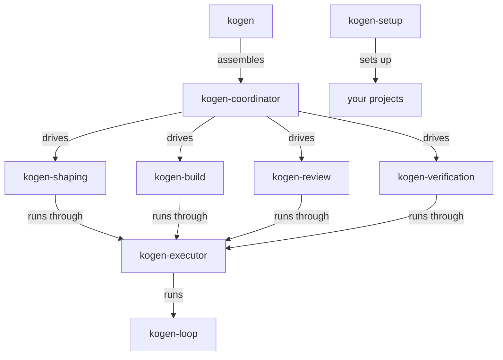

# Kogen

This repository is `kogen`, the command-line program that is Kogen's small core. It takes one requested feature through Shape, Build, Verify, Review and Commit in your own Git repository. For Kogen as a whole, see [kogen.dev](https://kogen.dev).

## Install

Development prereleases are published at https://github.com/KogenAI/kogen/releases, and `packaging/install-kogen.sh` installs them into `~/.local` without administrator rights. It runs on macOS on Apple Silicon and on Linux x86-64 with glibc. To build and install from source instead, you need Git, and Go 1.27 and Node 24 from `.tool-versions` (for example with [mise](https://mise.jdx.dev)).

```sh
git clone https://github.com/KogenAI/kogen
cd kogen
mise install                                   # Go and Node from .tool-versions
sh packaging/package.sh                        # builds dist/kogen-<version>-<platform>.tar.gz
tar -xzf dist/kogen-*.tar.gz -C /tmp
sh /tmp/kogen-*/install.sh                     # installs into ~/.local; needs no administrator rights
export PATH="$HOME/.local/bin:$PATH"           # if install.sh says ~/.local/bin is not on your PATH
kogen provider login chatgpt                   # signs in through your browser
```

## Quickstart

In a Git repository of your own with at least one commit (a Build needs a clean working tree, so keep the request file outside the repository, or commit it):

```sh
kogen init                                     # finds and checks the project's commands, commits .kogen/project.yaml and the model lineup .kogen/models.yaml
kogen intent shape my-feature ../request.md    # the request, kept outside the repository; answer questions on stdin: printf '1: a\n' | kogen intent shape my-feature -
kogen intent approve my-feature                # shows the card; approve with the hash it prints
kogen intent build my-feature                  # builds, verifies, reviews and commits
```

For a step-by-step guide from install to your first landed feature, see [docs/getting-started.md](docs/getting-started.md); `kogen help` lists every command.

## Kogen repositories

`kogen` pins the component repositories at exact versions in `cli/go.mod` and assembles them into one program; kogen-loop is kept as a pinned copy in `cli/third_party/kogen-loop/`.



| Repository | Responsibility | Link |
| --- | --- | --- |
| kogen | The command-line program that is Kogen's small core; it assembles the pinned components. | [KogenAI/kogen](https://github.com/KogenAI/kogen) |
| kogen-coordinator | Kogen's coordinator: the outer workflow's authority over a target repository. | [KogenAI/kogen-coordinator](https://github.com/KogenAI/kogen-coordinator) |
| kogen-shaping | Kogen's human-assisted shaping workflow: `kogen intent shape`, `refine` and `approve`. | [KogenAI/kogen-shaping](https://github.com/KogenAI/kogen-shaping) |
| kogen-build | Kogen's implementation workflow: `kogen intent build`, `resume` and `recover`. | [KogenAI/kogen-build](https://github.com/KogenAI/kogen-build) |
| kogen-review | Kogen's independent review and repair of a Build's verified candidate. | [KogenAI/kogen-review](https://github.com/KogenAI/kogen-review) |
| kogen-verification | Kogen's deterministic verification: running checks, scenarios and models, and recording the evidence. | [KogenAI/kogen-verification](https://github.com/KogenAI/kogen-verification) |
| kogen-executor | Kogen's shared execution and session contracts and its backend adapters. | [KogenAI/kogen-executor](https://github.com/KogenAI/kogen-executor) |
| kogen-loop | Standalone Go agent-loop library and CLI, using only the standard library. | [KogenAI/kogen-loop](https://github.com/KogenAI/kogen-loop) |
| kogen-setup | Kogen's setup: `kogen init` configures an existing project for Kogen. | [KogenAI/kogen-setup](https://github.com/KogenAI/kogen-setup) |

## More

- [Overview](docs/overview.md): the five steps, providers and Claude Code, status, specification, folder map, contact and license
- [Using Kogen](docs/using-kogen.md): getting started, checkout facts, usage, approval step limits and stale approval cards
- [Readiness, continuity and evidence](docs/readiness-and-custody.md): clean final readiness, private working continuity and source provenance, native image evidence
- [Contributing](docs/contributing.md): development setup and checks
